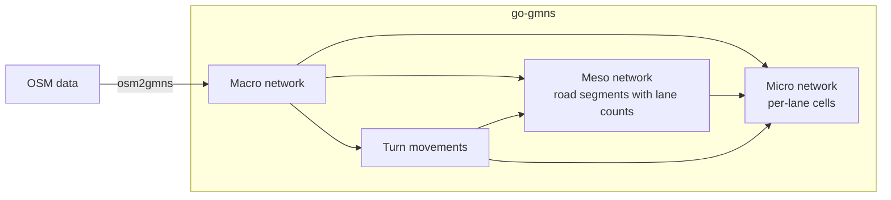
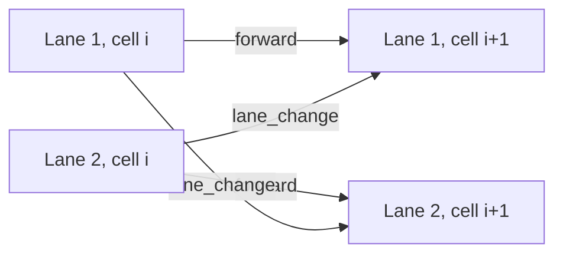

# GMNS - General Modeling Network Specification

Go data structures, validation and generators for macroscopic, mesoscopic and microscopic transportation networks. Created for [osm2gmns](https://github.com/LdDl/osm2gmns), usable independently.

Specification: [GMNS by the Zephyr Foundation and Volpe/FHWA](https://github.com/zephyr-data-specs/GMNS/tree/v0.97/spec).

## Contents

- [Installation](#installation)
- [Basic example](#basic-example)
- [Architecture](#architecture)
- [Current state](#current-state)
- [Units and limitations](#units-and-limitations)
- [Documentation](#documentation)
- [References](#references)

## Installation

Requires Go 1.23.4 or later.

```sh
go get github.com/LdDl/go-gmns
```

## Basic example

The [basic example](cmd/examples/basic/README.md) builds two nodes and one directed road link, validates the dataset and writes a GeoJSON FeatureCollection to stdout.

Run from the repository root:

```sh
go run ./cmd/examples/basic > network.geojson
```

See [main.go](cmd/examples/basic/main.go) for the complete code and [generation](docs/generation.md) for the macro-to-micro pipeline.

## Architecture

### Generation Pipeline

The OSM-to-macro step belongs to [osm2gmns](https://github.com/LdDl/osm2gmns). The remaining steps are provided by this library; callers can also construct macro networks directly.



### Network Resolution Levels

| Level | Representation | Possible downstream uses |
|---|---|---|
| Macro | Road links between intersections or topology changes; opposite directions can reference a shared geometry | Routing, traffic assignment |
| Meso | Directed road segments split at lane-count changes, with offset geometry and junction connectors; each road link can carry multiple lanes | Intersection analysis, movement connectivity |
| Micro | Chains of cells for individual lanes, with forward and adjacent-lane connections | Microscopic traffic simulation |

The library builds graphs; traffic assignment, signal optimization and vehicle simulation belong to downstream software.

### Data Flow Example

One directed road section with two lanes and no lane-count changes:

```text
Macro: A --[road link, lanes=2]--> B
Meso:  X --[road segment, lanes=2]--> Y
Micro: two rows of cells, one per lane
```

One micro step along that section (all arrows follow travel):



## Current state

| Capability | Support | Scope |
|---|---|---|
| Macro, meso and micro networks | Storage and validation | Nodes, links, attributes and references |
| Dataset records | Storage and validation | Configuration, geometries, zones, use definitions and groups |
| Lane, segment and segment-lane records | Storage, validation and supported meso preparation | Nonoverlapping segments and edge lane additions/drops |
| Movements | Storage at each network level; generation from macro | Generated meso/micro connectors retain source movement provenance |
| Meso and micro generation | Available | Requires prepared topology, geometry and lane data |
| Meso preparation from standard records | `generators.PrepareMesoscopic` | Rebuilds internal data; preserves source records and returns lineage |
| Local meso updates | `generators.UpdateMesoscopic` | Explicit road/lane edits and movement resolutions with stable surviving IDs |
| Local editing state | Save, restore and initialize supported prepared networks | Application metadata; restoration does not regenerate geometry |
| GeoJSON | Nodes, links and separately exported movements | Visualization output; does not serialize the complete dataset |
| WKT | `WKT()` on nodes, links, movements, geometries and zones | Two-dimensional geometry as a string |
| Geometry utilities | Available | Coordinate conversion, offsets and distances |

## Units and limitations

Working datasets use the **metric system**: lengths and altitudes in meters, speeds in km/h, time in seconds. Coordinates use WGS84 (`EPSG:4326`), in longitude/latitude order. Imperial-unit conversion and other coordinate reference systems are not implemented.

Node altitude is optional; line geometry remains two-dimensional. Generation does not infer heights for displaced points.

Generators require directed input links; represent two-way roads with two opposite directed links. Generated movements describe topology and lane connections, without interpreting OSM turn restrictions. Additional input requirements are listed in [generation](docs/generation.md#input-requirements).

Time-of-day, signal timing, location and curb records are outside the supported model. CSV dataset import/export is not provided by this package; see [osm2gmns](https://github.com/LdDl/osm2gmns) for OSM conversion and CSV output.

## Documentation

| Document | Contents |
|---|---|
| [Data model](docs/data-model.md) | Dataset ownership, attributes, references, calculated data, GeoJSON and WKT |
| [Types and constants](docs/types.md) | Built-in values for control, node, movement, road, agent, cell and infrastructure categories |
| [Generation](docs/generation.md) | Input preparation, generator calls, behavior and options |
| [Meso preparation](docs/meso-preparation.md) | Standard macro inputs, lane policies, results and supported detail |
| [Local meso updates](docs/meso-updates.md) | Supported edits, dependencies, identities and conflicts |
| [Saving local meso state](docs/meso-archives.md) | Archive continuation, historical imports and exact record preservation |
| [Basic example](cmd/examples/basic/README.md) | A runnable network construction and GeoJSON export example |

## References

Lu, J., & Zhou, X.S. (2023). Virtual track networks: A hierarchical modeling framework and open-source tools for simplified and efficient connected and automated mobility (CAM) system design based on general modeling network specification (GMNS). Transportation Research Part C: Emerging Technologies, 153, 104223. [Paper](https://linkinghub.elsevier.com/retrieve/pii/S0968090X23002127).
