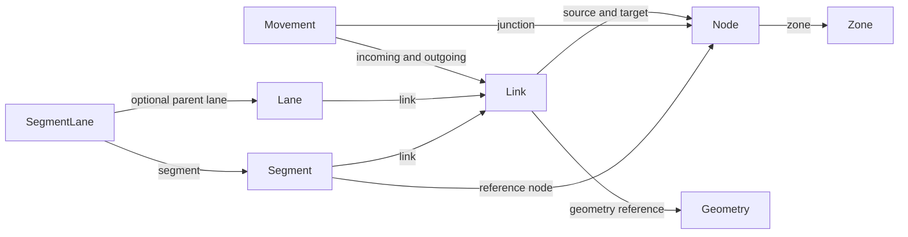
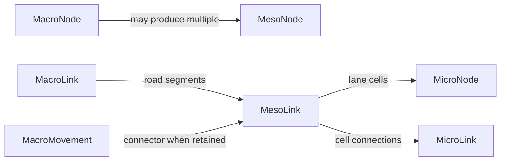

# Data model

[Back to README](../README.md)

Most of the original network dictionary was gracefully stolen from [OSM2GMNS](https://osm2gmns.readthedocs.io/en/stable/mrm.html). This reference describes the current Go implementation; the [GMNS specification](https://github.com/zephyr-data-specs/GMNS/tree/v0.97/spec) defines the interchange format.

## Contents

- [Identifiers and units](#identifiers-and-units)
- [Dataset records](#dataset-records)
- [Common node attributes](#common-node-attributes)
- [Common link attributes](#common-link-attributes)
- [Geometry references](#geometry-references)
- [Level-specific attributes](#level-specific-attributes)
- [Movements](#movements)
- [Calculated data](#calculated-data)
- [Relationships](#relationships)
- [GeoJSON export](#geojson-export)
- [WKT export](#wkt-export)

## Identifiers and units

IDs support strings and integers: `"001"`, `"1"` and integer `1` are distinct. Use typed constructors such as `gmns.NodeIDFromString("001")` or `gmns.NodeIDFromInt64(1)`. Each dataset uses one configured ID kind. A zero-value ID denotes absence; numeric `0` and `-1` are valid IDs.

The model uses the **metric system**: meters for lengths, widths and altitude, km/h for speeds, and seconds for time. Coordinates use WGS84 (`EPSG:4326`) in longitude/latitude order. Link capacity is in passenger-car equivalents (PCE) per hour per lane; movement capacity is for the whole movement in PCE/hour. Toll amounts use the dataset currency.

Optional numeric attributes distinguish absence from zero. Their getters return `(value, present)`; omission of an option leaves the attribute absent. This differs from older OSM provenance fields and calculated indices that still use `-1` as a sentinel.

## Dataset records

Each `macro.Net`, `meso.Net` and `micro.Net` owns its configuration and record collections. References to zones, geometries, uses, lanes and segments resolve within that network. Movement node/link references also resolve within their owning network.

| Record | Contents | Access on Net |
|---|---|---|
| `gmns.Config` | Dataset name, ID kind, currency, optional version number; fixed units and CRS | `SetConfig`, `Config` |
| `gmns.Geometry` | `GeometryID` and an `orb.LineString` | `AddGeometry`, `Geometry`, `GeometryRecords` |
| `gmns.Zone` | `NodeID`, name, optional boundary (`orb.MultiPolygon`) and super-zone reference | `AddZone`, `Zone`, `ZoneRecords` |
| `gmns.UseDefinition` | Use name, persons per vehicle, PCE factor, conditions and description | `AddUseDefinition`, `UseDefinition`, `UseDefinitionRecords` |
| `gmns.UseGroup` | Group name, list of use-definition names and description | `AddUseGroup`, `UseGroup`, `UseGroupRecords` |
| `movement.Movement` | Maneuver between local links at a local node | `AddMovement`, `Movement`, `MovementRecords` |
| `gmns.Lane` | `LaneID`, link reference, lane number, allowed uses, barriers and optional width | `AddLane`, `Lane`, `LaneRecords` |
| `gmns.Segment` | `SegmentID`, link and reference-node IDs, start/end distances, optional road attributes | `AddSegment`, `Segment`, `SegmentRecords` |
| `gmns.SegmentLane` | `SegmentLaneID`, segment reference, lane number, optional parent lane, uses, barriers and width | `AddSegmentLane`, `SegmentLane`, `SegmentLaneRecords` |

Catalog and movement/detail collection reads return copies; their `Update…` and `Remove…` methods check the resulting dataset or live references. Nodes and links remain in the network's `Nodes` and `Links` maps. Set a configuration and call `ValidateDataset()` after assembling a dataset to check values and references together.

Segments can carry grade, capacity, speed, lane count, left/right lane additions, infrastructure, uses, toll, jurisdiction and right-of-way width. Supplied lane and segment records are independent of the lane arrays used by the current generators. Use groups contain concrete use definitions, not other groups.

## Common node attributes

The following tables use **current GeoJSON property names**, not Go field names or a CSV schema. Node geometry is an `orb.Point` obtained through `Geom()` and written to the feature's `geometry`, not to longitude/latitude properties. Category values are listed in [types and constants](types.md).

| Property | Type | Meaning |
|---|---|---|
| `id` | integer/string | Node identifier |
| `parent_node_id` | optional integer/string | Parent node within this network |
| `name` | string | Node name |
| `node_type` | string | Description of what the node represents |
| `control_type` | string | Control category |
| `z_coord` | optional float64 | Altitude in meters, stored independently of the 2D geometry |
| `zone_id` | optional integer/string | Zone in this network's zone catalog |
| `boundary_type` | string | Network boundary classification |

## Common link attributes

Link geometry is an `orb.LineString` obtained through `Geom()` and exported as a GeoJSON LineString. These properties are shared by macro, meso and micro links.

| Property | Type | Meaning |
|---|---|---|
| `id` | integer/string | Link identifier |
| `parent_link_id` | optional integer/string | Parent link within this network |
| `source_node`, `target_node` | integer/string | Endpoints within this network |
| `name` | string | Link name |
| `directed` | bool | Travel restricted to source-to-target order; default `true` |
| `control_type` | string | Control category |
| `grade` | optional float64 | Grade in percent; negative is downhill |
| `row_width` | optional float64 | Entire right-of-way width across both directions, in meters |
| `jurisdiction` | string | Road owner/operator |
| `bike_facility`, `ped_facility`, `parking` | string | Infrastructure categories |
| `facility_type` | string | Supplied facility classification |
| `toll` | optional float64 | Amount in dataset currency units |
| `allowed_agent_types` | string | Comma-separated built-in agent values |
| `allowed_uses` | string | Comma-separated references to use definitions or groups |
| `free_speed` | optional float64 | Free-flow speed in km/h |
| `capacity` | optional float64 | Saturation capacity in PCE/hour/lane |
| `length_meters` | optional float64 | Supplied link length in meters |

`LanesNum()` stores an optional motor-vehicle lane count at every level. GeoJSON calls it `lanes` for macro/micro and `lanes_num` for meso. In micro it is independent of the calculated lane index. Length is supplied explicitly; setting geometry does not calculate it.

## Geometry references

All three link models support these optional attributes, which their current GeoJSON exporters do not include:

| Attribute | Getter | Meaning |
|---|---|---|
| `geometry_id` | `GeometryID()` | Reference to a geometry record in the owning network |
| `dir_flag` | `DirFlag()` | `1` follows the referenced shape; `-1` reverses its order relative to the link endpoints |

Setting a reference or direction does not reverse or replace `Geom()`. If both inline and referenced geometry are supplied, dataset validation checks that they agree with the direction. A shared shape can be referenced by opposite directed links with opposite direction flags.

For the micro graph produced by the current generator, `geometry_id` and `dir_flag` have no practical use: each cell or lane-change link already carries its own geometry in travel order. Both attributes remain available for supplied GMNS records and are left unset by the generator.

## Level-specific attributes

These properties supplement the common node/link tables. Source IDs describe provenance in another network; they are distinct from same-network `parent_node_id` and `parent_link_id`.

### Macro

| Object | Property | Type | Meaning |
|---|---|---|---|
| Node | `osm_node_id` | integer | Source OSM node ID; `-1` when unavailable |
| Node | `intersection_id`, `poi_id` | integer | Intersection cluster / POI identifiers; `-1` when unavailable |
| Node | `osm_highway` | string | Source OSM highway tag |
| Node | `activity_type`, `activity_link_type` | string | Activity classification and associated road category |
| Link | `osm_way_id` | integer | Source OSM way ID; `-1` when unavailable |
| Link | `source_osm_node_id`, `target_osm_node_id` | integer | Source OSM endpoint IDs; `-1` when unavailable |
| Link | `link_class`, `link_type` | string | Transport class and road category |
| Link | `is_link` | string | Connecting-way classification: `no` or `yes` |
| Link | `was_bidirectional` | bool | Whether the source way was bidirectional |
| Link | `max_speed` | float64 | Maximum speed in km/h; `-1` when unavailable |

### Meso

| Object | Property | Type | Meaning |
|---|---|---|---|
| Node | `macro_node_id`, `macro_link_id` | optional integer/string | Source macro node or link |
| Node | `activity_link_type` | string | Activity road category |
| Link | `macro_node_id`, `macro_link_id` | optional integer/string | Source junction or road link |
| Link | `movement_id` | optional integer/string | Source macro movement for a connector |
| Link | `movement_composite_type` | string | Source movement code |
| Link | `link_type` | string | Road category |

A meso road link can represent multiple lanes. A macro node can expand into several meso nodes; uncontrolled junction shortcuts can also merge connection endpoints. Segment indices and connector lane mappings belong to the [calculated data](#calculated-data), not this GeoJSON property table.

### Micro

| Object | Property | Type | Meaning |
|---|---|---|---|
| Node | `meso_link_id` | optional integer/string | Source meso link |
| Node | `lane_id` | int | Calculated lane index within the meso link |
| Node | `cell_index` | int | Cell position along the lane, starting at zero |
| Node | `is_upstream_end`, `is_downstream_end` | bool | Position at a meso-link endpoint |
| Link | `meso_link_id`, `macro_link_id`, `macro_node_id` | optional integer/string | Source road or junction provenance |
| Link | `cell_type` | string | `undefined`, `forward` or `lane_change` |
| Link | `lane_id` | int | Calculated lane index |
| Link | `is_first_movement_cell` | bool | First cell of a movement connection |
| Link | `movement_composite_type` | string | Source movement code |
| Link | `additional_travel_cost` | float64 | Additional travel cost used for lane changes |
| Link | `meso_link_type` | string | Source meso road category |

The exported micro `lane_id` is a calculated index, not a reference to a `gmns.Lane` record.

## Movements

Movements connect an incoming link to an outgoing link at a node in their owning network. Macro generation derives candidate maneuvers from topology and lane data; it does not interpret OSM turn restrictions. Generated meso/micro networks retain source movement provenance in connectors but leave their own movement collections empty.

| GeoJSON property | Type | Meaning |
|---|---|---|
| `id` | integer/string | Movement identifier |
| `node_id` | integer/string | Junction in the owning network |
| `in_link_id`, `out_link_id` | integer/string | Incoming and outgoing links in the owning network |
| `name` | string | Movement name |
| `in_lane_start`, `out_lane_start` | optional int | First lane number on the corresponding link |
| `in_lane_end`, `out_lane_end` | optional int | Last lane number; absent with a supplied start denotes a single lane |
| `lanes_num` | int | Movement lane count; `-1` when unavailable |
| `type` | string | Movement category |
| `movement_composite_type` | string | Direction/maneuver code |
| `control_type` | string | Control category |
| `penalty` | optional float64 | Supplied turn penalty in seconds |
| `capacity` | optional float64 | Capacity of the whole movement in PCE/hour |
| `allowed_agent_types` | string | Comma-separated built-in agents |
| `allowed_uses` | string | Comma-separated use/group references |
| `osm_node_id` | integer | Source OSM junction ID; `-1` when unavailable |
| `from_osm_node_id`, `to_osm_node_id` | integer | Source OSM approach/departure endpoint IDs; `-1` when unavailable |

Movement `Geom()` is an `orb.LineString`, exported as feature geometry. The exporter also writes `volume` and `free_speed` as fixed `-1` placeholders; the movement model does not currently store these attributes. Penalty is supplied by the caller, not calculated by the movement generator.

## Calculated data

These APIs support generation and are not additional GMNS record tables. Except for the micro indices described above, these values are not included by the current GeoJSON exporters.

| Object | API | Meaning |
|---|---|---|
| Macro node | `IncomingLinks()`, `OutcomingLinks()` | Prepared adjacency used by movement generation |
| Nodes, links, movements | `GeomEuclidean()` | Prepared projected geometry used for calculations |
| Macro link | `LanesInfo()` | Lane counts, left/right count changes and breakpoints along the link |
| Meso link | `SegmentIdx()` | Segment index within the source macro link |
| Meso link | `IsConnection()` | Whether this is a junction connector |
| Meso link | `LanesChange()` | `[2]int`: left and right lane-count changes relative to the source lane layout |
| Meso link | `MovementMesoLinkIncome()`, `MovementMesoLinkOutcome()` | Meso links connected by a junction connector |
| Meso link | `MovementIncomeLaneStartSeqID()`, `MovementOutcomeLaneStartSeqID()` | Calculated starting lane indices for connector construction |
| Movement | `StartIncomeLaneSeqID()`, `EndIncomeLaneSeqID()` | Calculated incoming lane-index range |
| Movement | `StartOutcomeLaneSeqID()`, `EndOutcomeLaneSeqID()` | Calculated outgoing lane-index range |

Calculated lane indices are separate from optional supplied lane numbers such as `IncomeLaneStart()`. In particular, meso links do not expose four supplied `in/out_lane_start/end` attributes like movements do.

## Relationships

Within each network, link endpoints and movement references resolve locally; catalog records belong to the same network:



Generation provenance connects separate networks and does not impose a one-to-one mapping of IDs:



IDs in these relationships use the configured string or integer kind. Source provenance can be checked separately with the meso/micro `ValidateSourceReferences` methods.

## GeoJSON export

`Net.GeoFeatureCollection()` exports nodes and links. `MovementsStorage.GeoFeatureCollection()` exports movements separately. Feature geometry contains coordinates; optional numeric/reference properties use `null` when absent, while absent descriptive strings remain empty.

This output is for graph visualization. It does not include configuration, geometry/zone/use catalogs, supplied lane/segment tables or the network's owned movements automatically. It also does not define the CSV columns produced by [osm2gmns](https://github.com/LdDl/osm2gmns).

## WKT export

Use `node.WKT()`, `link.WKT()`, `movement.WKT()`, `geometry.WKT()` or `zone.WKT()` to obtain a string. Nodes produce `POINT`, links/movements/geometry records produce `LINESTRING`, and zone boundaries produce `MULTIPOLYGON`, including holes.

```go
text := link.WKT()
```

Encoding preserves the stored two-dimensional WGS84 coordinates and their order. It does not add an SRID prefix, apply `dir_flag`, resolve a shared geometry reference or include the separate altitude attribute. Empty lines and zone boundaries produce `LINESTRING EMPTY` and `MULTIPOLYGON EMPTY`.

`WKT()` serializes without validating or repairing geometry. Use the existing record or dataset validators when validation is needed.
